# Learner Credential Wallet

A cross-platform (iOS / Android) mobile wallet for **W3C Verifiable Credentials** and **Open Badges v3**. It lets a learner receive, store, verify, and selectively share digital academic credentials — entirely on-device, under their own cryptographic keys.

Built with **Expo SDK 53**, **React Native 0.79.6**, **React 19**, and an **encrypted Realm** database.

---

## Table of Contents

1. [What It Does](#1-what-it-does)
2. [Technology Stack](#2-technology-stack)
3. [System Architecture](#3-system-architecture)
4. [Project Structure](#4-project-structure)
5. [Data Model (UML Class Diagram)](#5-data-model-uml-class-diagram)
6. [Application Lifecycle (State Machine)](#6-application-lifecycle-state-machine)
7. [Navigation Map](#7-navigation-map)
8. [State Management](#8-state-management)
9. [Core Workflows (Sequence Diagrams)](#9-core-workflows-sequence-diagrams)
10. [Security Model](#10-security-model)
11. [External Services](#11-external-services)
12. [Deep Links](#12-deep-links)
13. [Getting Started](#13-getting-started)
14. [Testing](#14-testing)
15. [Known Issues](#15-known-issues)

---

## 1. What It Does

| Capability | Description |
|---|---|
| **Receive** | Accepts credentials via deep link, QR code, VC-API exchange, or file/PNG import |
| **Verify** | Cryptographically verifies signatures and checks the issuer against known DID registries |
| **Store** | Persists credentials in an AES-encrypted Realm database on the device only |
| **Organize** | Multiple *profiles*, each with its own DID and its own credential set |
| **Share** | Verifiable Presentations, QR codes, public links, PDF export, LinkedIn |
| **Backup** | Full wallet or per-profile JSON export via the native share sheet |

**Key principle:** there is no server-side account. Private keys and credentials never leave the device unless the user explicitly shares them.

---

## 2. Technology Stack

| Layer | Technology |
|---|---|
| Runtime | React Native 0.79.6, React 19, Hermes |
| Framework | Expo SDK 53 (dev-client, bare workflow via prebuild) |
| Language | TypeScript 5.8 |
| State | Redux Toolkit + React-Redux 9 |
| Database | Realm 20.1.0 (AES-256 encrypted) |
| Navigation | React Navigation 6 (stack + bottom tabs) |
| Key storage | `expo-secure-store` (Keychain / Keystore) + `react-native-keychain` for biometrics |
| Crypto / VC | `@digitalcredentials/*` — `vc`, `verifier-core`, `ssi`, `did-method-key`, `vpqr`, `ezcap` |
| Signature suites | Ed25519Signature2020, EdDSA-RDFC-2022 |
| Camera | `react-native-vision-camera` 4.7.1 (QR scanning) |
| UI | React Native Elements, React Native Paper, custom theming |

> **Architecture note:** the New Architecture (Fabric/TurboModules) is **disabled** — `newArchEnabled=false` in both `android/gradle.properties` and the `expo-build-properties` plugin. Several native dependencies do not yet support it.

---

## 3. System Architecture

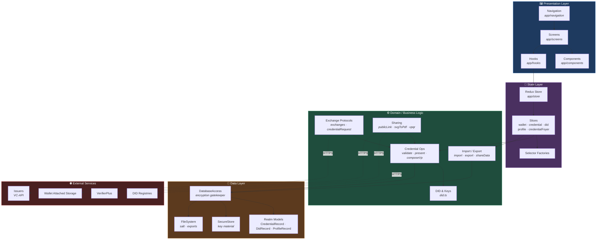

**Dependency rule:** dependencies point downward. Screens never touch Realm directly — every read/write goes through a Redux thunk, which calls a model static method, which calls `DatabaseAccess.withInstance()`.

---

## 4. Project Structure

```
learner-credential-wallet/
├── App.tsx                    # Root: Redux Provider → ThemeProvider → AppNavigation
├── index.js                   # Entry: polyfills, global Realm, registerRootComponent
├── shim.js                    # Node-API polyfills (Buffer, process, crypto)
├── crypto-polyfill.js         # crypto.getRandomValues / pbkdf2 shims
├── app.config.js              # Expo config + wallet config + feature flags
│
└── app/
    ├── assets/                # Icons, splash, fonts
    ├── components/            # 27 reusable UI components
    ├── hooks/                 # 14 custom hooks
    ├── init/                  # logger.ts, registries.ts (startup side effects)
    ├── lib/                   # 45 modules — the domain layer
    ├── mock/                  # Fixtures for tests / dev
    ├── model/                 # Realm schemas + DatabaseAccess
    ├── navigation/            # 11 navigators
    ├── screens/               # 26 screens
    ├── store/                 # Redux store, 5 slices, selector factories
    ├── styles/                # Theme system (light/dark)
    └── types/                 # Shared TypeScript types
```

### The `lib/` domain layer, grouped by concern

| Concern | Modules |
|---|---|
| **Credential lifecycle** | `validate` · `verifiableObject` · `credentialHash` · `credentialValidityPeriod` · `credentialSecurity` · `credentialName` |
| **DID & keys** | `did` · `biometrics` · `registerWallet` |
| **Presentation** | `present` · `composeVp` · `credentialsFromPresentation` · `credentialsFromVpqr` |
| **Exchange** | `exchanges` · `credentialRequest` · `interactionUrl` · `handleZcapRequest` · `walletRequestApi` |
| **Sharing** | `publicLink` · `shareData` · `shareRequest` · `svgToPdf` · `selectCredentials` · `credentialMatching` |
| **Storage** | `export` · `import` · `parseWallet` · `asyncStorage` · `cache` · `walletAttachedStorage` |
| **Support** | `error` · `text` · `time` · `encode` · `decode` · `dynamicStyles` · `globalModal` |

---

## 5. Data Model (UML Class Diagram)

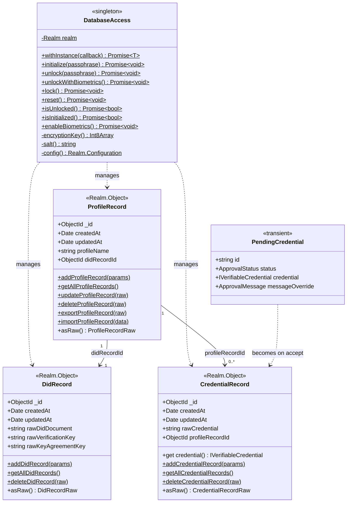

### Notes on the schema

- Relationships are **soft foreign keys** (`ObjectId` fields), not Realm link properties. Joins happen in Redux selector factories such as `makeSelectDidForCredential`.
- `rawCredential`, `rawDidDocument`, and the key fields are stored as **JSON strings**, not nested objects — this keeps the schema stable as VC shapes evolve.
- `PendingCredential` lives only in the `credentialFoyer` Redux slice. It is the staging area between "received" and "accepted".
- Schema version is derived automatically: `schemaVersion = migrations.length` in `app/model/migration.ts`.
- `ObjectId`s are generated from `crypto.randomBytes(12)` rather than Realm's default, to avoid a `crypto.getRandomValues` path that is unreliable on React Native.

---

## 6. Application Lifecycle (State Machine)

`AppNavigation` is a pure function of two booleans from the `wallet` slice — `isInitialized` and `isUnlocked`:

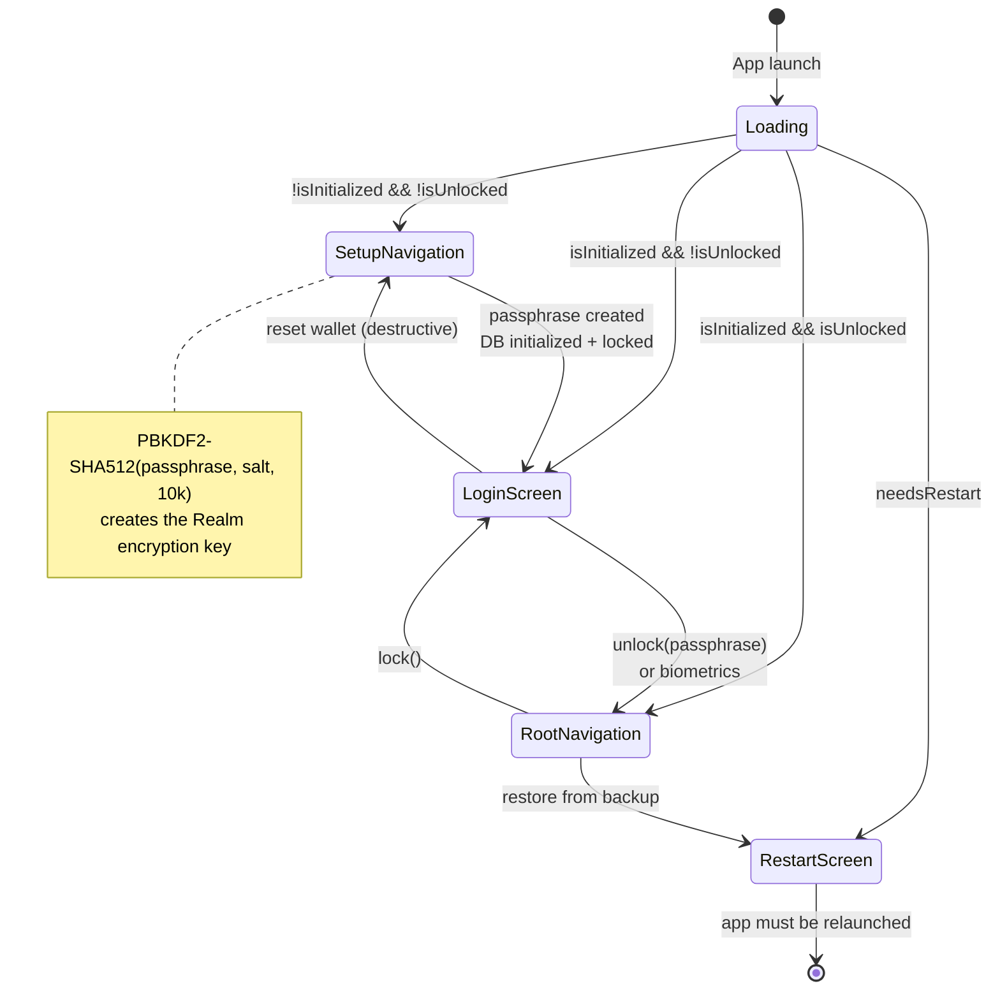

Implementation — `app/navigation/AppNavigation/AppNavigation.tsx`:

```tsx
if (needsRestart)                       return <RestartScreen />
else if (isUnlocked && isInitialized)   return <RootNavigation />
else if (!isUnlocked && isInitialized)  return <LoginScreen />
else if (!isUnlocked && !isInitialized) return <SetupNavigation />
else                                    return null
```

---

## 7. Navigation Map

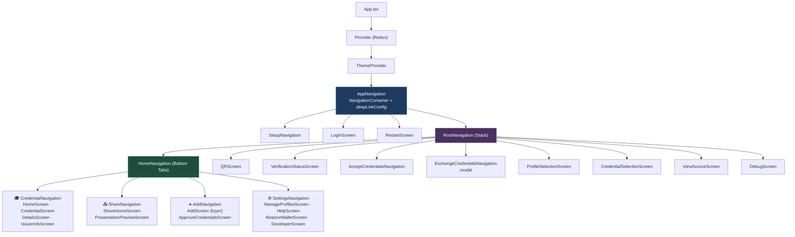

---

## 8. State Management

Five Redux Toolkit slices. `serializableCheck` is disabled because Realm `ObjectId`s and `Date`s flow through actions.

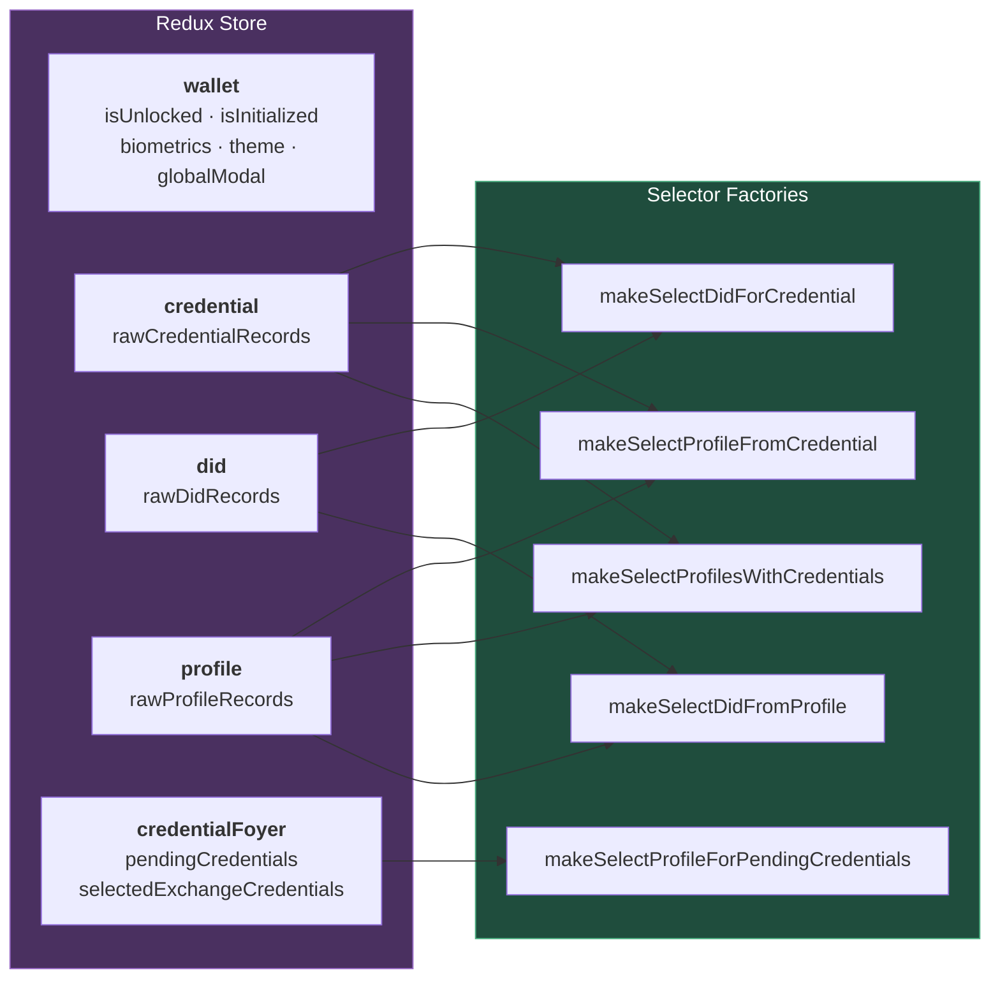

Because the Realm records are flat and use soft foreign keys, the selector factories are where the object graph is actually assembled. `getAllRecords()` is the thunk that rehydrates all three record slices after unlock.

---

## 9. Core Workflows (Sequence Diagrams)

### 9.1 Wallet Setup and Unlock

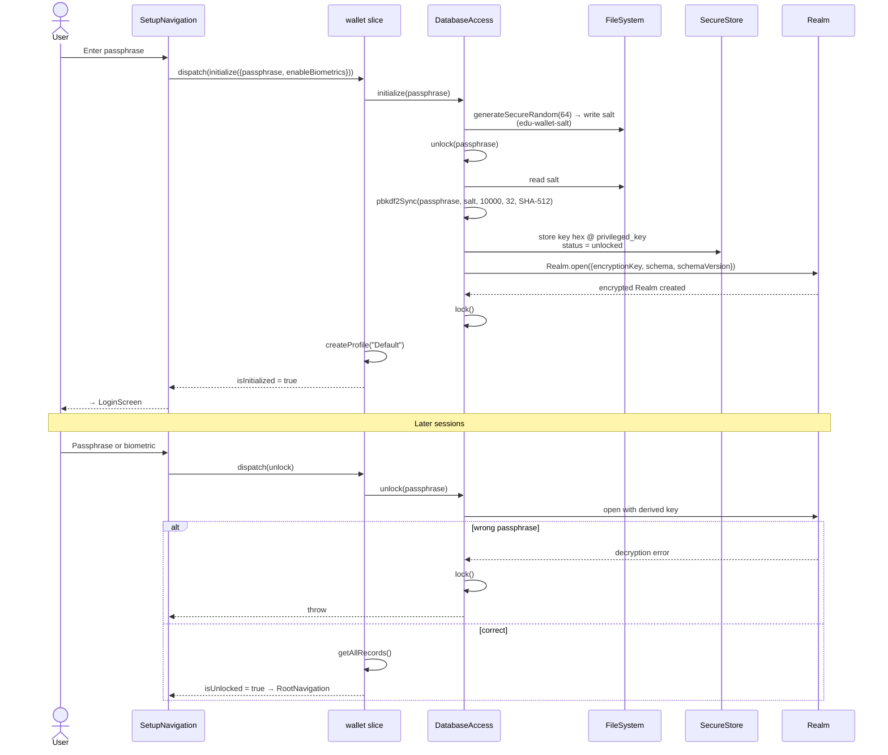

### 9.2 Receiving a Credential (Deep Link / VC-API)

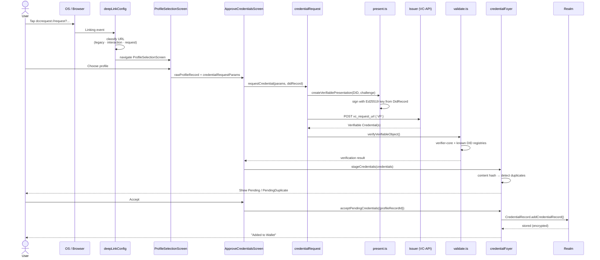

### 9.3 Credential Verification

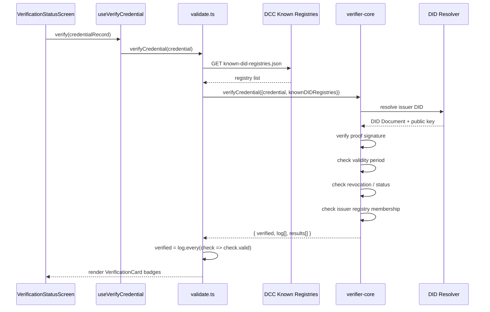

The final `verified` flag is recomputed locally from the log rather than trusted directly — every individual check must pass.

### 9.4 Sharing a Credential

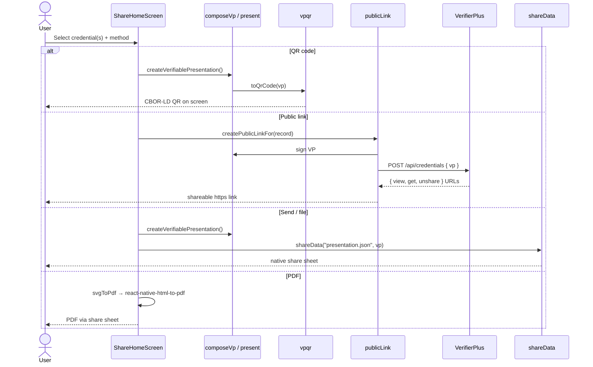

### 9.5 Backup and Restore

```mermaid
sequenceDiagram
    actor User
    participant S as SettingsNavigation
    participant EX as export.ts
    participant PR as ProfileRecord
    participant SD as shareData
    participant FS as FileSystem
    participant IM as import.ts
    participant PW as parseWallet

    rect rgb(30,58,95)
    Note over User,FS: Export
    User->>S: "Backup my wallet"
    S->>EX: exportWallet()
    EX->>PR: getAllProfileRecords()
    loop each profile
        EX->>PR: exportProfileRecord()<br/>(profile + DID + credentials)
    end
    EX->>SD: shareData("Wallet Backup.json", json)
    SD->>FS: write to DocumentDirectoryPath
    SD-->>User: native share sheet
    end

    rect rgb(31,77,61)
    Note over User,PW: Import
    User->>S: "Restore"
    S->>IM: pickAndReadFile()
    IM->>IM: DocumentPicker → RNFS.readFile
    alt PNG Open Badge
        IM->>IM: scan PNG bytes for<br/>"openbadgecredential" JSON
    else JSON
        IM->>IM: read UTF-8
    end
    IM->>PW: parseWalletContents(data)
    PW->>PR: importProfileRecord()
    PR-->>User: import report<br/>(success / duplicate / failed)
    end
```

---

## 10. Security Model

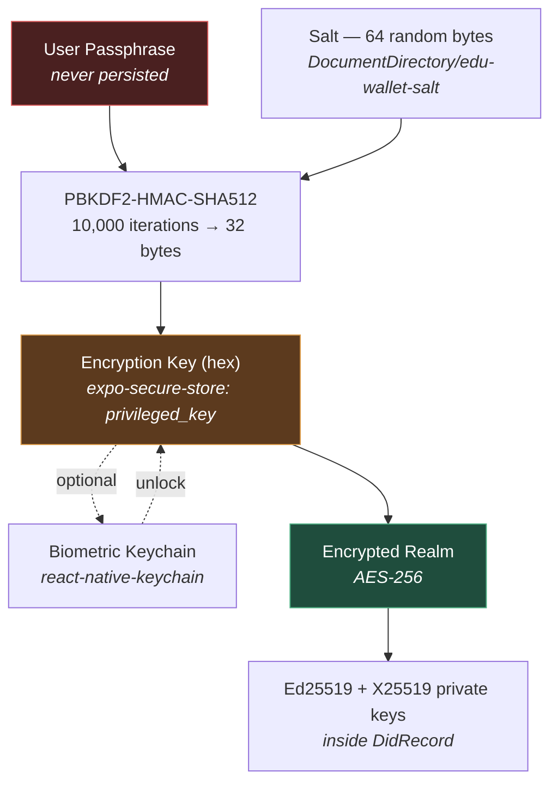

| Control | Implementation |
|---|---|
| Key derivation | PBKDF2-HMAC-SHA512, 10,000 iterations, 32-byte output |
| Salt | 64 cryptographically random bytes, generated once at setup |
| Database encryption | Realm AES-256 via `encryptionKey` in the Realm config |
| Key storage | `expo-secure-store` → iOS Keychain / Android Keystore |
| Biometrics | Optional; the derived key is stored behind a biometric-gated keychain entry |
| Passphrase | Never written to disk — exists only as a function argument |
| Lock | Drops the in-memory Realm reference and clears the key from SecureStore |
| Signing keys | Ed25519 (`did:key`), generated from 32 bytes of secure random per profile |

Documented invariants in `DatabaseAccess.ts`:

> 1. Never store/persist the passphrase.
> 2. Never store the generated key anywhere but SecureStorage.
> 3. Never hold onto the Realm instance — do all work inside the `withInstance` callback.

**Threat model caveats.** This is a device-local wallet. It protects credentials at rest against someone with filesystem access, but not against a compromised OS, a rooted/jailbroken device, or a user who exports an unencrypted backup. Backups produced by `exportWallet()` are **plaintext JSON containing private keys** — anyone holding that file controls those DIDs.

---

## 11. External Services

| Service | URL | Purpose |
|---|---|---|
| VerifierPlus | `https://verifierplus.org` | Hosts public shareable links for credentials |
| DCC Known Registries | `digitalcredentials.github.io/dcc-known-registries` | Issuer trust list used during verification |
| DCC Pilot / Sandbox / Community / DCC Registry | `digitalcredentials.github.io/*-registry` | Individual issuer registries |
| Wallet Attached Storage | `https://storage.dcc.did.coop` | Optional remote credential storage (zcap-authorized) |
| Registration | `https://lcw.app/register-wallet.html` | Wallet registration handoff |

All are configurable in `app.config.js`. **If you fork this wallet, point `VERIFIER_INSTANCE_URL` at your own verifier instance.**

---

## 12. Deep Links

| Scheme | Example | Handler |
|---|---|---|
| `dccrequest://request` | `dccrequest://request?issuer=…&vc_request_url=…` | Credential issuance |
| `dccrequest://present` | `dccrequest://present?…` | Presentation request |
| `interaction:` | `interaction:/…` | VC-API exchange |
| `org.dcconsortium://` | legacy | Legacy request format |
| `https://lcw.app/request` | universal link | Credential issuance |
| `https://lcw.app/mobile` | universal app link | Generic app open |

Routing lives in `app/lib/deepLinkConfig.ts`, which classifies each incoming URL into one of three paths before handing off to React Navigation:

```
isLegacyCredentialRequest(url) → goToCredentialFoyer(params)
isInteractionUrl(url)          → redirectInteractionUrl(url)
url.includes('request=')       → redirectRequestRoute(url)
otherwise                      → React Navigation linking
```

---

## 13. Getting Started

### Prerequisites

| Tool | Version |
|---|---|
| Node.js | 20+ (tested on 24) |
| JDK | **21** (Android Studio's bundled JBR works) |
| Android SDK | compileSdk 35, minSdk 29, buildTools 34.0.0 |
| Xcode | 15+ (macOS only, for iOS) |
| Gradle | 8.13 (via wrapper) |

> ⚠️ **JDK 21 is required.** Gradle 8.13 / React Native 0.79 do not support JDK 25. If your `JAVA_HOME` points at a newer JDK, override it:
>
> ```bash
> # macOS / Linux
> export JAVA_HOME="/path/to/jdk-21"
> # Windows (PowerShell)
> $env:JAVA_HOME = "C:\Program Files\Android\Android Studio\jbr"
> ```

### Install

```bash
npm install          # runs patch-package via postinstall
```

The `patches/` directory contains required fixes to third-party packages — do not skip `postinstall`.

### Generate native projects

`android/` and `ios/` are **gitignored**; they are generated by Expo prebuild:

```bash
npm run prebuild:android
npm run prebuild:ios
```

### Run

```bash
npm run android      # expo run:android — builds and installs the dev client
npm run ios          # expo run:ios (macOS only)
npm start            # Metro only, for an already-installed dev client
```

This app uses **expo-dev-client**, so it cannot run in Expo Go — a native build is mandatory.

#### Faster emulator builds

By default both `x86_64` and `arm64-v8a` are compiled. For an x86_64 emulator, restrict the ABI in `android/gradle.properties`:

```properties
reactNativeArchitectures=x86_64
```

This roughly halves build time and avoids compiling native code you cannot run.

### Code quality

```bash
npm run lint         # prettier --check + tsc --noEmit
npm run lint:fix     # prettier --write + typecheck
npm run compile      # tsc --noEmit only
```

A Husky `pre-commit` hook runs `lint-staged` (prettier) on staged JS/TS files.

---

## 14. Testing

```bash
npm test             # jest + node test runner
npm run test-jest    # Jest (jest-expo preset)
npm run test-node    # node --test with tsx
npm run coverage     # coverage report
npm run test:ui      # Maestro E2E
```

| Layer | Tool | Location |
|---|---|---|
| Unit / component | Jest + `@testing-library/react-native` | `test/` |
| Node-side logic | `node --test` + tsx | `test-node/` |
| End-to-end | Maestro | `.maestro/` |

---

## 15. Known Issues

### `ninja: manifest 'build.ninja' still dirty after 100 tries`

Occurs while building `react-native-vision-camera`'s C++ on Windows. Causes and fixes:

1. **Cloud-synced folder** (OneDrive, Dropbox, Google Drive). The sync client rewrites file mtimes mid-build, so ninja keeps re-detecting a dirty manifest. Move the project outside the synced folder, or pause syncing during builds.
2. **Unnecessary ABI.** Set `reactNativeArchitectures=x86_64` as above.
3. **Stale CMake cache.** `rm -rf node_modules/react-native-vision-camera/android/.cxx`

### `Tried to access a JS module before the React instance was fully set up`

Thrown from `CameraDevicesManager.kt` at startup. `react-native-vision-camera` 4.7.1 emits `availableDevicesChanged` before the bridge finishes initializing, on the old architecture. It is non-fatal — the app recovers and Metro continues bundling — but it surfaces as a red-box crash in dev builds.

### `expo-system-ui: The current activity is no longer available`

Follow-on noise from the above crash/restart cycle, not an independent defect.
